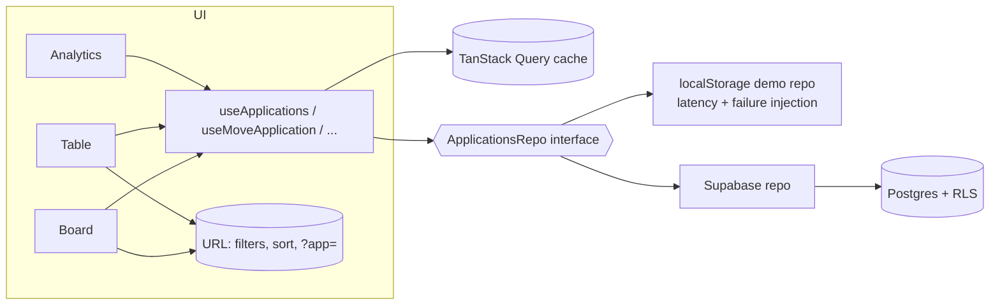

# Pipeline — a job-search tracker

Track every internship application from **wishlist → applied → OA → interview → offer** on a
Kanban board, a virtualized table and an analytics dashboard. Built because I was managing 100+
applications in a spreadsheet and kept missing follow-ups.

> **Try it in 10 seconds:** `npm install && npm run dev`, then click **Explore with sample data**.
> No account needed. Demo mode stores data in your browser.

<!-- Add after deploying: live demo link · 90-second Loom walkthrough · screenshot/GIF of the board -->

## Features

|                        |                                                                                                                                                                          |
| ---------------------- | ------------------------------------------------------------------------------------------------------------------------------------------------------------------------ |
| **Kanban board**       | Drag between stages with mouse, touch **or keyboard** (Space to pick up, arrows to move, Space to drop, Esc to cancel), with screen-reader announcements for every step. |
| **Optimistic updates** | Moves, edits and deletes show instantly and **roll back with an explanation** if the save fails.                                                                         |
| **Undo**               | Deleting shows a 6-second "Undo" toast that restores the exact record (same id, history and position).                                                                   |
| **Table view**         | Sort any column; virtualized so 2,000+ rows scroll smoothly (only a few dozen rows are ever in the DOM).                                                                 |
| **URL state**          | Search, filters, sort _and the open editor_ live in the URL. Links are shareable, reloads keep your view, and Back closes the editor.                                    |
| **Analytics**          | Funnel, weekly activity, response rate by source (which channel actually gets replies), median time to reply, and a _Due soon_ list of follow-ups and deadlines.         |
| **Command palette**    | <kbd>⌘K</kbd> / <kbd>Ctrl K</kbd> to jump anywhere, search applications or run actions. <kbd>N</kbd> for a new application, <kbd>/</kbd> to search.                      |
| **CSV import/export**  | RFC 4180 parser (quotes, newlines in cells, BOM), per-row validation with line-numbered errors, and spreadsheet formula-injection protection.                            |
| **Auth**               | Supabase email/password + GitHub OAuth, protected routes, and return to the page you were heading to. Or zero-setup demo mode.                                           |
| **Polish**             | Dark mode (no flash on load), skeleton loading states, empty and error states, route-level error boundaries, responsive down to 360px, `prefers-reduced-motion`.         |

### Demo controls (⚙ menu)

To make the hard parts visible, demo mode can **simulate network latency** and **make 30% or 100%
of saves fail**. Turn failures on and drag a card to watch the optimistic update roll back. Use
**Load 2,000 rows** to stress-test the virtualized table.

## Tech stack

| Concern       | Choice                                                                    | Why                                                |
| ------------- | ------------------------------------------------------------------------- | -------------------------------------------------- |
| UI            | React 19, TypeScript (strict, `noUncheckedIndexedAccess`), Vite           |                                                    |
| Routing       | React Router 7                                                            | URL as the source of truth for view state          |
| Server state  | **TanStack Query**                                                        | Caching, optimistic mutations, invalidation        |
| Client state  | Zustand (theme, palette, demo settings only)                              | Everything else is server or URL state             |
| Forms         | React Hook Form + **Zod**                                                 | One schema drives validation, types and CSV import |
| Drag and drop | dnd-kit                                                                   | Built-in keyboard sensor and live-region API       |
| Table         | TanStack Table + TanStack Virtual                                         |                                                    |
| Charts        | Recharts (lazy-loaded)                                                    |                                                    |
| UI primitives | Radix (Dialog, Dropdown), cmdk, sonner, Tailwind CSS 4                    | Accessible behaviour without a heavy kit           |
| Backend       | Supabase (Postgres + Auth + **Row-Level Security**)                       | Or the built-in localStorage demo backend          |
| Testing       | Vitest, React Testing Library, Playwright, axe-core                       |                                                    |
| CI            | GitHub Actions: lint, typecheck, coverage, bundle budget, E2E, Lighthouse |                                                    |

## Architecture



**What happens when you drag a card** (and the save fails):

1. `onDragEnd` computes a fractional `position` between the new neighbours (only the moved card is written).
2. `useMoveApplication` → `onMutate`: cancel in-flight fetches, snapshot the cache, write the new stage, position and **history event** into the cache. The UI updates immediately.
3. The request fails → `onError` restores the snapshot and shows _"Couldn't move Stripe to Interview — it's back where it was."_
4. `onSettled` refetches, but only when it's the **last** in-flight write, so a slow early request can't overwrite a newer optimistic state.

## Decisions and trade-offs

- **Three kinds of state, three homes.** Server data → TanStack Query. Shareable view state (filters,
  sort, which application is open) → the URL. Purely local UI (theme, palette open) → a tiny Zustand
  store. No Redux needed.
- **A repository interface instead of calling Supabase from components.** This is what makes the
  zero-setup demo mode possible. It also makes the hooks testable against an in-memory repo, and
  would make a backend swap a one-file change.
- **Client-generated UUIDs.** Optimistic rows have their final id from the start, so React keys and
  open `?app=` links never change when the server responds.
- **Stage history, not just current stage.** Without it, "rejected after the final round" and
  "rejected the next day" look identical, and the funnel and response-rate numbers would be wrong.
- **Fractional indexing for ordering.** A move writes one row, not a whole column. Trade-off: after
  many moves in the same gap the floats get dense. A periodic rebalance would fix that; it's not
  needed at this scale.
- **Bundle discipline.** Zod-free constants live in their own module. supabase-js is imported only
  when configured. The form, command palette, CSV code and charts are lazy chunks. Recharts is the
  biggest dependency and only loads on `/analytics`.
- **Testing strategy.** Pure logic (metrics, filters, CSV, positions) is unit tested exhaustively.
  Hooks are tested with a controllable fake repo, which lets tests assert the _intermediate_ optimistic
  state. Real interactions (drag, keyboard, file import, a11y) are tested in Playwright against the
  production build.

## Quality bar (measured, not estimated)

| Metric                                  | Result                                                                                                                                                                                       |
| --------------------------------------- | -------------------------------------------------------------------------------------------------------------------------------------------------------------------------------------------- |
| Unit and component tests                | **63** tests, **93.5%** line coverage on `src/lib`, `src/hooks` and the repo (CI fails under 80%)                                                                                            |
| End-to-end tests                        | **18** Playwright flows: auth, create, edit, delete + undo, keyboard drag, mouse drag, failed-save rollback, URL filters, sorting, 2,000-row virtualization, command palette, CSV round-trip |
| Accessibility                           | **0 axe violations** (WCAG 2.1 AA) on login, board, table, analytics and the editor, in light _and_ dark theme                                                                               |
| Lighthouse (`/login`, production build) | Performance **98**, Accessibility **100**, Best Practices **100**                                                                                                                            |
| Initial JS                              | **171 KB** gzipped (CI budget: 200 KB). Board route +19 KB, table +25 KB, analytics +108 KB (lazy)                                                                                           |
| Mobile                                  | No horizontal page scroll at 360px (checked in E2E)                                                                                                                                          |

Lighthouse was measured locally against `vite preview`, which serves uncompressed files, so a
deployed build on a CDN should do at least as well.

## Getting started

```bash
npm install
npm run dev            # http://localhost:5173 — demo mode
```

### Use a real backend (optional)

1. Create a Supabase project and run [`supabase/schema.sql`](supabase/schema.sql) in the SQL editor.
2. (Optional) Enable the GitHub provider under Authentication → Providers.
3. `cp .env.example .env.local` and fill in `VITE_SUPABASE_URL` and `VITE_SUPABASE_ANON_KEY`.

### Scripts

|                                         |                                                                   |
| --------------------------------------- | ----------------------------------------------------------------- |
| `npm run dev`                           | Dev server                                                        |
| `npm test` / `npm run test:coverage`    | Vitest                                                            |
| `npm run test:e2e`                      | Playwright (builds and serves the production bundle in demo mode) |
| `npm run lint` / `npm run typecheck`    | ESLint (incl. `jsx-a11y`) / `tsc`                                 |
| `npm run build && npm run check:bundle` | Production build + bundle budget                                  |

Deploy: import the repo into Vercel (the included `vercel.json` handles SPA routing) and add the
two env vars, or deploy with none for a public demo.

## Project structure

```
src/
  api/         repository interface, localStorage + Supabase implementations, seed data
  auth/        auth context, provider, route guard
  lib/         pure logic: schema, metrics, filters, CSV, fractional positions (100% unit tested)
  hooks/       TanStack Query hooks (optimistic), URL-state hooks, hotkeys
  features/    board, table, analytics, applications (form/sheet/filters), command palette
  components/  layout, menus, primitives
  pages/       route components (lazy-loaded)
e2e/           Playwright + axe specs
supabase/      schema + RLS policies
```

## What I'd do next

- Real-time sync across tabs/devices with Supabase Realtime (reconcile with optimistic state)
- Offline queue for writes (PWA + background sync)
- Follow-up reminder emails via a scheduled Edge Function
- Next.js/SSR for a public "my job hunt" share page with good link previews
